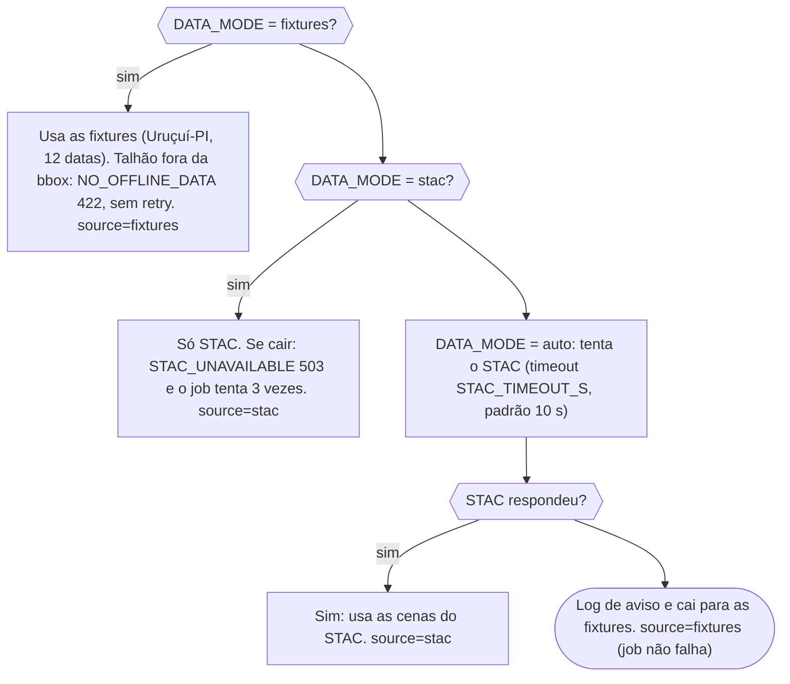

# AgroSat

Monitoramento de lavouras por satélite. Você desenha (ou importa) o contorno de um talhão, o AgroSat busca imagens Sentinel-2 dos últimos 6 meses, calcula o NDVI, separa o talhão em zonas de vigor baixo, médio e alto e avisa quando algo piora (queda geral ou mancha). No fim, gera um relatório em PDF.

Serviços: `web` (Next.js), `api` (NestJS + Prisma + BullMQ), `worker` (FastAPI, processamento de imagens), Postgres/PostGIS e Redis.

## Arquitetura

```mermaid
sequenceDiagram
    participant Web
    participant API
    participant Fila
    participant Worker
    participant Fonte
    participant Banco
    Web->>API: POST /plots/:id/process
    API->>Banco: Transação: trava o talhão (FOR UPDATE) e procura job queued/running
    API-->>Web: 409 JOB_IN_PROGRESS se já houver job ativo
    API->>Banco: INSERT job (status queued)
    API->>Fila: add history (3 tentativas, backoff exponencial de 5 s)
    API-->>Web: 202 com jobId
    Web->>API: GET /jobs/:id (consulta o status)
    Fila->>API: Consumer entrega o job (concorrência 2)
    API->>Banco: job running; lê o talhão; janela = hoje − 6 meses
    API->>Worker: POST /process (geometria + janela, timeout WORKER_TIMEOUT_MS)
    Worker->>Fonte: list_scenes conforme DATA_MODE (stac, fixtures ou auto com fallback)
    Fonte-->>Worker: Arquivos B04, B08 e SCL por data
    Worker->>Worker: Pipeline: NDVI, máscara, estatísticas, zonas e alertas
    Worker->>Worker: Grava PNG, GeoTIFF e GeoJSON no volume /data
    Worker-->>API: 200 com source e scenes[]
    API->>Banco: Transação: upsert de cenas, zonas e alertas; remove o que sumiu; needsReprocess
    API->>Banco: job completed com validScenes, discardedScenes e source
    API->>API: Notificação simulada: log notification.simulated (telefone ***)
    Web->>API: GET scenes, zones e alerts: desenha o mapa
```

Fonte de dados do worker:



Mais diagramas (jornada, persistência, regras de alerta, estados do job, LGPD): [docs/fluxos.md](docs/fluxos.md). Decisões de projeto: [DECISIONS.md](DECISIONS.md). Pendências: [TODO.md](TODO.md).

## Como subir

Pré-requisitos: Docker com Compose, `make`, `curl` e `jq` (usados pelo `make demo`).

```bash
docker compose up -d --build --wait   # ou: make up
make demo                             # sobe em modo fixtures, migra, popula a fazenda demo e processa
```

Depois abra http://localhost:3005. A API fica em http://localhost:3001/api/v1.

`make demo` fixa `DATA_MODE=fixtures`, roda `prisma migrate deploy` e `prisma db seed` e espera todos os jobs da "Fazenda Demo Uruçuí" terminarem (`scripts/wait-jobs.sh`, timeout de 600 s). Pode rodar de novo: o reprocessamento reaproveita job em andamento.

### Portas configuráveis

Se alguma porta do host estiver ocupada, defina no `.env` (ou na linha de comando):

| Variável | Padrão |
|---|---|
| `WEB_HOST_PORT` | 3005 |
| `API_HOST_PORT` | 3001 |
| `POSTGRES_HOST_PORT` | 5432 |
| `REDIS_HOST_PORT` | 6379 |
| `WORKER_HOST_PORT` | 8000 (só em 127.0.0.1, apenas com `docker compose --profile debug up -d worker-debug`; o worker não tem porta pública por padrão) |
| `THROTTLE_LIMIT` / `THROTTLE_TTL` | 600 req / 60 s por IP na API |

Atenção: `NEXT_PUBLIC_API_URL` é embutida no build do `web`. O compose a monta a partir de `API_HOST_PORT`; se você mudar a porta da API, reconstrua o web (`docker compose up -d --build web`). Mudar só em runtime não tem efeito. Se mudar `WEB_HOST_PORT`, ajuste também `WEB_ORIGIN` (CORS da API).

## Modos de dados

`DATA_MODE` é lido pelo worker:

- `fixtures`: usa imagens sintéticas determinísticas de Uruçuí-PI (bbox ~10x10 km em -7,23, -44,55; 12 datas). Não precisa de internet para os dados. Talhão fora dessa área falha com `NO_OFFLINE_DATA`.
- `stac`: só o catálogo STAC público (Earth Search, Sentinel-2 L2A). Se estiver fora do ar, o job falha após 3 tentativas. O contorno do talhão sai da sua máquina na consulta.
- `auto` (padrão do compose): tenta o STAC (`STAC_TIMEOUT_S`, padrão 10 s) e, se falhar, cai para as fixtures com aviso no log.

Nota sobre basemap offline: o mapa de fundo (satélite ESRI) é carregado do navegador e precisa de rede mesmo em `fixtures`. Sem rede, o NDVI e as zonas aparecem, mas o fundo fica em branco. `NEXT_PUBLIC_BASEMAP_URL` permite apontar para outro serviço de tiles, e também é embutida no build.

## Testes

```bash
make test     # jest (api) + pytest (worker) + lint
make lint     # eslint (api, web) e ruff (worker)
make e2e      # Playwright contra o compose em modo fixtures
make audit    # npm audit e pip-audit
make fixtures # regenera as fixtures sintéticas
```

Os testes rodam sem rede: o pytest bloqueia sockets e o Playwright intercepta os tiles do basemap. A integração da API usa o Postgres do compose.

## Como o NDVI funciona (sem jargão)

Pense no NDVI como um boletim de saúde da planta, feito pela luz que ela reflete. Folha saudável absorve muita luz vermelha (para fazer fotossíntese) e reflete muita luz infravermelha próxima. Planta estressada, solo exposto ou palha fazem o contrário. O satélite mede as duas cores e o AgroSat compara:

`NDVI = (infravermelho − vermelho) / (infravermelho + vermelho)`

O resultado vai de -1 a 1. Perto de 0 é solo nu; valores altos (acima de ~0,6) indicam vegetação vigorosa. É uma nota por pixel de 10 m, e o AgroSat resume a nota do talhão (média, mediana, p10 e p90).

Nuvens e sombras atrapalham a leitura, então são descartadas por uma máscara. Se mais de 60% do talhão estiver coberto, a data inteira é ignorada, e você vê só as datas "válidas" na linha do tempo.

### Zonas

O AgroSat divide o talhão em três faixas pela nota de cada pixel naquela data: o terço mais fraco é zona baixa, o terço do meio é média e o terço mais forte é alta. Servem para ver onde a lavoura está desigual e, se quiser, baixar o GeoJSON das zonas para uma máquina de taxa variável. A divisão é relativa ao próprio talhão, não uma nota absoluta.

### Alertas

- Queda: a média da data nova é comparada com a das 3 últimas datas válidas. Queda de 15% a 25% gera alerta de severidade média; mais de 25%, alta. Precisa de pelo menos 3 datas anteriores.
- Mancha: pixels piores que o pior 10% do histórico do talhão e que formam uma área contígua. A maior mancha entre 1 e 3 ha gera alerta médio; acima de 3 ha, alto. "Ver no mapa" enquadra a mancha.

Os alertas são sinais para você ir olhar o campo, não um diagnóstico. A notificação por WhatsApp é simulada (só aparece no log).

## Privacidade e LGPD (resumo)

- Sem conta, login ou cookies: o MVP é de tenant único e sem autenticação.
- Dados guardados: nome/município/UF da fazenda, nome e contorno dos talhões, e os resultados derivados (NDVI, zonas, alertas, PDFs).
- O telefone informado na notificação simulada nunca é guardado nem logado (o log mostra `***`).
- Exclusão: `DELETE /farms/:id` ou `/plots/:id` apaga tudo em cascata no banco e, depois do commit, as pastas em `/data`.
- Janela de dados: os processamentos usam os últimos 6 meses (em `fixtures` a janela é ignorada e vêm sempre as 12 datas).
- Em `stac` e `auto` o contorno do talhão é enviado ao STAC público. Use `DATA_MODE=fixtures` para nada sair da máquina.
- Não há exportação de dados do titular nem log de auditoria (ver [TODO.md](TODO.md)). Mapa completo em `docs/fluxos.md`, seção E.

## Solução de problemas

- Porta ocupada (`address already in use`): defina a variável `*_HOST_PORT` correspondente (tabela acima) e suba de novo. Se mudou `API_HOST_PORT`, reconstrua o web.
- Job parado em `queued`, ou processando em dobro (consumidores soltos na fila): uma API antiga (por exemplo rodando local fora do Docker) pode estar consumindo o mesmo Redis. Pare-a e, se preciso, limpe o estado: `docker compose down -v` apaga volumes (inclusive os dados) e recria tudo do zero.
- Job `failed` com `WORKER_UNAVAILABLE` ou `WORKER_TIMEOUT`: confira `docker compose ps` e `docker compose logs worker`. O job tenta 3 vezes; depois use "Processar" de novo. Rodando a API fora do Docker, suba o perfil `debug` (`docker compose --profile debug up -d worker-debug`) e use `WORKER_URL=http://localhost:${WORKER_HOST_PORT}`; dentro do compose é `http://worker:8000`.
- `NO_OFFLINE_DATA`: o talhão está fora da região das fixtures. Desenhe dentro da área de Uruçuí-PI ou use `DATA_MODE=stac`/`auto` com internet.
- Mapa sem fundo: o basemap precisa de rede (ver "Modos de dados").
- `make demo` falha com `fazenda demo nao encontrada`: o seed não rodou; confira `docker compose logs api`.
