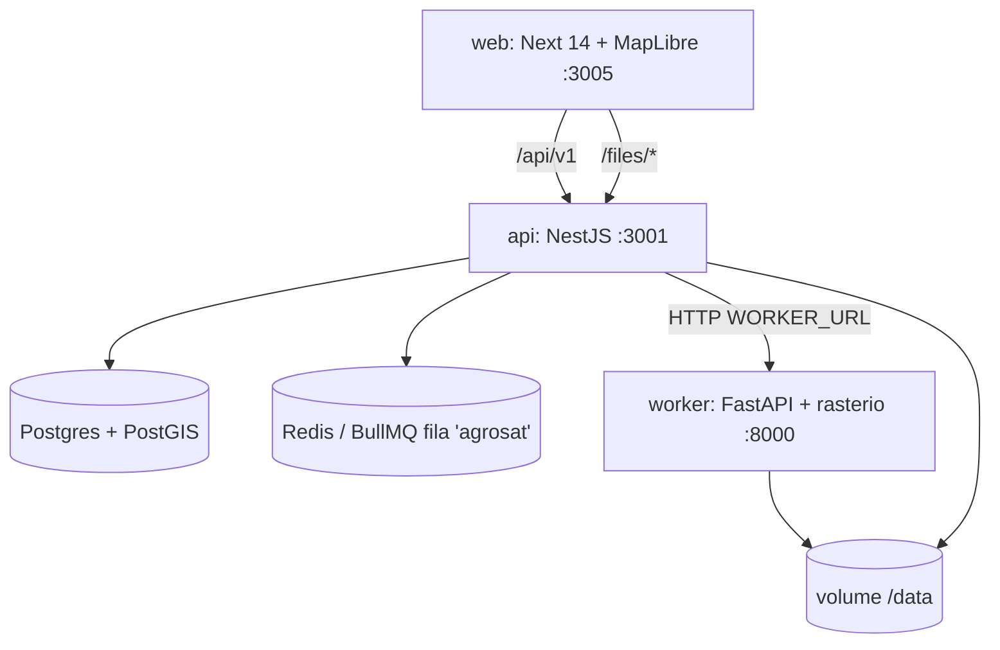
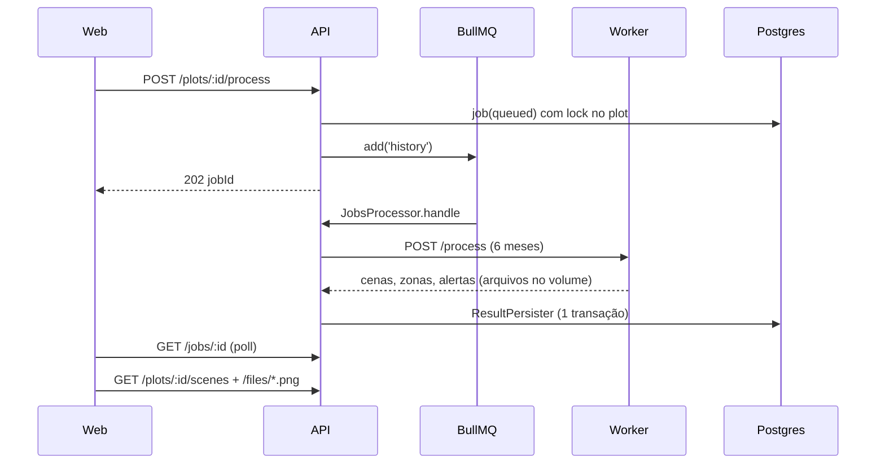

# Codebase Map

> Gerado pelo Cartographer em 2026-11-05T10:25:36Z. `previews/` e `docs/specs` não foram lidos; propósito dos componentes web inferido por nome/imports.

## Visão geral

## Raiz
| Path | Papel |
|---|---|
| `api/` | NestJS 10 + Prisma + PostGIS. Prefixo `/api/v1`, Swagger em `/api/docs` |
| `worker/` | FastAPI + rasterio + numpy + shapely. Stateless, sem acesso ao banco |
| `web/` | Next 14 + MapLibre GL 4 (não subir p/ 6.x) + Tailwind (paleta pt-BR: `folha`, `solo`, `tinta`) |
| `e2e/` | Playwright, 1 worker, chromium swiftshader |
| `docker-compose.yml` | postgres (postgis 16-3.4), redis 7, worker, worker-debug (profile `debug`), api, web. Volumes `pgdata`, `agrosat-data` (`/data`) |
| `Makefile` | `up demo test test-int lint e2e fixtures audit audit-strict` |
| `scripts/e2e.sh` | Sobe stack isolada (`agrosate2e`, `DATA_MODE=fixtures`, `NEXT_PUBLIC_E2E=1`) se API fora, migra, seed, `wait-jobs.sh`, Playwright, `down -v` |
| `scripts/wait-jobs.sh` | Processa "Fazenda Demo Uruçuí" e espera job (precisa `jq`) |
| `DECISIONS.md` / `docs/fluxos.md` | ADR-01..08, P1-P4; fluxos, regras RN-01..15, matriz regra→impl→teste, LGPD |

## Entry points
- API: `api/src/main.ts` → `assertEnv()` (`DATABASE_URL`, `REDIS_URL`, `WORKER_URL`) → `setupApp` (`setup.ts`: prefixo, helmet, CORP em `/files`, CORS `WEB_ORIGIN`, validation pipe, `HttpExceptionFilter`)
- Worker: `worker/app/main.py` (lifespan `assert_env()`: `DATA_DIR`, `DATA_MODE`)
- Web: `web/app/layout.tsx`, `page.tsx` (fazendas); `/farms/[id]`, `/farms/[id]/map` (UI principal), `/alerts`, `/privacidade`
- Seed: `api/prisma/seed.ts` lê `SEED_GEOJSON` (`worker/fixtures/demo-plots.geojson`)

## api/src
Padrão por módulo: `.module/.controller/.service/.repository(SQL raw PostGIS)/dto.ts/.spec.ts`.

| Módulo | Pontos-chave |
|---|---|
| `app.module.ts` | `ThrottlerGuard` global (`THROTTLE_TTL/LIMIT`) |
| `common/` | `errors.ts` (`AppException`, mapa `ErrorCode`→HTTP, `UuidPipe`→404), `validation.ts`, `http-exception.filter.ts` (`{code,message,details}`), `pagination.dto.ts`, `geo.ts` (`parseGeoFile` geojson/json/kml, 5 MB) |
| `farms/` | CRUD, `dashboard.service.ts` (1 query LATERAL, trend `FLAT=0.02`), `remove` cascata + apaga volumes após commit |
| `plots/` | `plots.repository.ts` (geometria SQL raw, `ST_Area` geography), `importItems` (MultiPolygon explodido), PATCH geometria → `needsReprocess=true` |
| `jobs/` | `jobs.service.ts` (`enqueue/enqueueFarm/enqueueOrReuse`, `FOR UPDATE` no plot), `jobs.processor.ts` (BullMQ, concurrency 2, `WORKER_FACTORY` p/ teste), `worker.client.ts` (`WORKER_TIMEOUT_MS`), `result.persister.ts` (1 transação) |
| `scenes/` `zones/` `alerts/` | leitura de cenas/pixel (proxy ao worker `/pixel`), zonas GeoJSON, alertas (`upsert`, `deleteMissingInWindow`) |
| `notifications/` | WhatsApp simulado (RN-11); telefone nunca persistido/logado |
| `reports/` | `report.runner.ts` → worker `/report`; job tipo `report` |
| `files/` | `GET /files/*` serve o volume (único caminho público) |

### Rotas (`/api/v1`)
`GET /health` · `GET|POST /farms` · `GET|PATCH|DELETE /farms/:id` · `GET /farms/:id/dashboard` · `POST /farms/:id/process` (202 `{jobIds}`) · `GET|POST /farms/:farmId/plots` · `POST /farms/:farmId/plots/import` · `GET|PATCH|DELETE /plots/:id` · `POST /plots/:id/process` (202 `{jobId}`, 409 `JOB_IN_PROGRESS`) · `GET /jobs/:id` · `GET /plots/:id/scenes|zones|pixel` · `GET /alerts` · `POST /notifications/whatsapp` · `POST /plots/:id/reports` · `GET /plots/:id/reports/latest` · `GET /files/*`

## api/prisma
- Modelos: Farm, Plot (`geom Unsupported(geometry(Polygon,4326))`, `areaHa`, `needsReprocess`), NdviScene (unique `[plotId,sceneDate]`, `source stac|fixtures`), Zone, Alert (unique `[plotId,sceneDate,type]`), Job (id = jobId BullMQ), Report. FKs filhas com `onDelete: Cascade`, tabelas snake_case
- Migrations: só `0001_init` (PostGIS dentro). Aplicada nunca editada; `migrate dev` precisa shadow DB com PostGIS (postgres do compose)
- Geometria `Unsupported` → só `$queryRaw/$executeRaw`

## api/test
`plots-app.ts` (helper), `security`, `geo`, `files`, `plots-import`, `notifications-privacy` specs; `integration/*.int-spec.ts` (`npm run test:int`, `--runInBand`, Postgres do compose). Regex jest: `(src|test)/(?!integration).*\.spec\.ts$`

## worker/app
| Arquivo | Papel |
|---|---|
| `main.py` | `/health`, `/process`, `/pixel`, `/report`; `_write_scene` grava `ndvi.png`, `ndvi.tif`, `zones.geojson`; `_safe()` bloqueia path traversal; erros `{code,message}` |
| `pipeline.py` | `process_plot`: clip B04/B08/SCL, SCL 20→10 m, NDVI, máscara, stats, zonas, PNG, alertas por cena em ordem de data |
| `ndvi.py` `mask.py` | `INVALID_SCL={3,8,9,10}`; >60% inválido descarta (`MAX_INVALID_PCT`) |
| `stats.py` `zones.py` | mean/median/p10/p90; zonas por quantis 33/66 |
| `alerts.py` | `drop_alert` (<0,85 / <0,75 da mediana das 3 últimas); `patch_alert` (maior mancha contígua < p10 histórico: >1 ha média, >3 ha alta) |
| `render.py` | rampa 4 paradas, `lonlat_bounds` |
| `report.py` | `build_pdf` (matplotlib + reportlab), `recommendations` |
| `sources/` | `list_scenes` por `DATA_MODE`; `stac.py` (earth-search, nuvem <60); `fixtures.py` (ignora janela, 12 cenas) |

`worker/scripts/gen_fixtures.py`: rasters sintéticos determinísticos (seed 20250101, EPSG:32723, 1000x1000 @10 m, 12 datas a cada 15 dias). `worker/tests` bloqueia rede (`conftest.py`); rodar com `.venv/bin/pytest`.

## web
| Path | Papel |
|---|---|
| `lib/api.ts` | objeto `api` tipado, `ApiRequestError(status,code,msg,details)`, BASE `NEXT_PUBLIC_API_URL` |
| `lib/api-types.ts` `geo.ts` `format.ts` | tipos DTO; `boundsToCoords` etc.; formatadores pt-BR |
| `app/farms/[id]/map/page.tsx` | orquestra plots, cenas válidas, `useTimeline`, `useCompare`; deep link `?plot=&date=&bbox=`; `MapView`/`DrawControl` dynamic `ssr:false` |
| `components/map/` | `MapView` (`window.__map` só com `NEXT_PUBLIC_E2E=1`; basemap ESRI), `DrawControl`, `ZonesLayer`, `CompareMap`, `PixelPopup`, `Legend`, `ImportButton` |
| `components/timeline/Timeline.tsx` | `useTimeline` (play 900 ms) |
| `components/panel/` | `SidePanel`, `ProcessButton` (poll `getJob`), `ReportButton` |
| `components/charts/NdviChart.tsx`, `PlotCard`, `FarmForm`, `PrivacyNotice` | |

Asserções de UI por `data-testid`/atributos, nunca por pixel do mapa.

## e2e
`tests/helpers.ts` (tiles ESRI → `blank-tile.png`, `apiPost/apiGet/waitJob`), specs `main-flow`, `mobile`, `report`.

## Fluxo: criar talhão → processar → mapa

- Erros `NO_OFFLINE_DATA`, `NO_VALID_SCENE`, `NOT_FOUND` → `UnrecoverableError` (sem retry); demais retry 3x (backoff exp. 5 s); job fica `running` entre tentativas
- Persister apaga cenas/alertas da janela que sumiram (P2) e zera `needsReprocess` só se `plot.updatedAt <= readAt`
- Worker falha → API mapeia `WORKER_TIMEOUT` / `WORKER_UNAVAILABLE`; falha ao enfileirar → `QUEUE_UNAVAILABLE`

## Env
| Serviço | Vars |
|---|---|
| API | obrigatórias `DATABASE_URL REDIS_URL WORKER_URL`; opcionais `PORT WORKER_TIMEOUT_MS(120000) DATA_DIR SEED_GEOJSON WEB_ORIGIN THROTTLE_LIMIT THROTTLE_TTL PUBLIC_FILES_URL` |
| Worker | obrigatórias `DATA_DIR DATA_MODE`; opcionais `FIXTURES_DIR STAC_URL STAC_COLLECTION STAC_TIMEOUT_S` |
| Web (build) | `NEXT_PUBLIC_API_URL NEXT_PUBLIC_BASEMAP_URL NEXT_PUBLIC_E2E` |
| Host | `API_HOST_PORT 3001`, `WEB_HOST_PORT 3005`, `POSTGRES/REDIS/WORKER_HOST_PORT` |

## Gotchas
- `NEXT_PUBLIC_*` embutida no build: mudou `API_HOST_PORT` → rebuild web; mudou `WEB_HOST_PORT` → ajustar `WEB_ORIGIN`
- Não rodar `nest start --watch` em paralelo (compartilha `api/dist`); processos soltos consomem a fila
- `DATA_MODE=fixtures` ignora janela de 6 meses; `auto` cai p/ fixtures se STAC falhar
- Sem teste da janela de 6 meses (RN-06), ver `docs/fluxos.md` seção D
- `lint`/`test` offline; testes do worker bloqueiam rede

## Navegação: para adicionar X, tocar Y
| Tarefa | Arquivos |
|---|---|
| Endpoint API | controller + service + repository + `dto.ts` do módulo; `ErrorCode` em `common/errors.ts`; spec; no web `lib/api.ts` + `api-types.ts` |
| Tabela/coluna | `schema.prisma` + nova migration `000N_*` (nunca editar `0001`); repositórios, seed, matriz D de `docs/fluxos.md` |
| Componente web | `web/components/<área>/`, `"use client"` (+ `dynamic ssr:false` se MapLibre), ligar em `map/page.tsx`, `data-testid` + caso e2e |
| Rota do worker | modelo pydantic + rota em `main.py` (`WorkerError`, `_safe()`); método em `worker.client.ts`; teste em `test_api.py` |
| Novo índice (tipo NDVI) | função ao lado de `ndvi.py`, chamar em `pipeline.process_plot`; campos em `main.py`, `worker.client.ts`, `result.persister.ts`, schema + migration |
| Novo alerta | regra em `alerts.py` + `pipeline.py`; enum `AlertType` (migration); `alerts.repository.ts` e texto de notificação |
| Nova fonte de dados | `list_scenes` em `worker/app/sources/` + registro em `__init__.py`; enum `SceneSource` (migration); `test_sources.py` |
| Fixtures | `gen_fixtures.py` + `demo-plots.geojson` + checksum em `test_fixtures.py` |
| Novo tipo de job | enum `JobType` (migration), branch em `JobsProcessor.handle`, método de enqueue |
