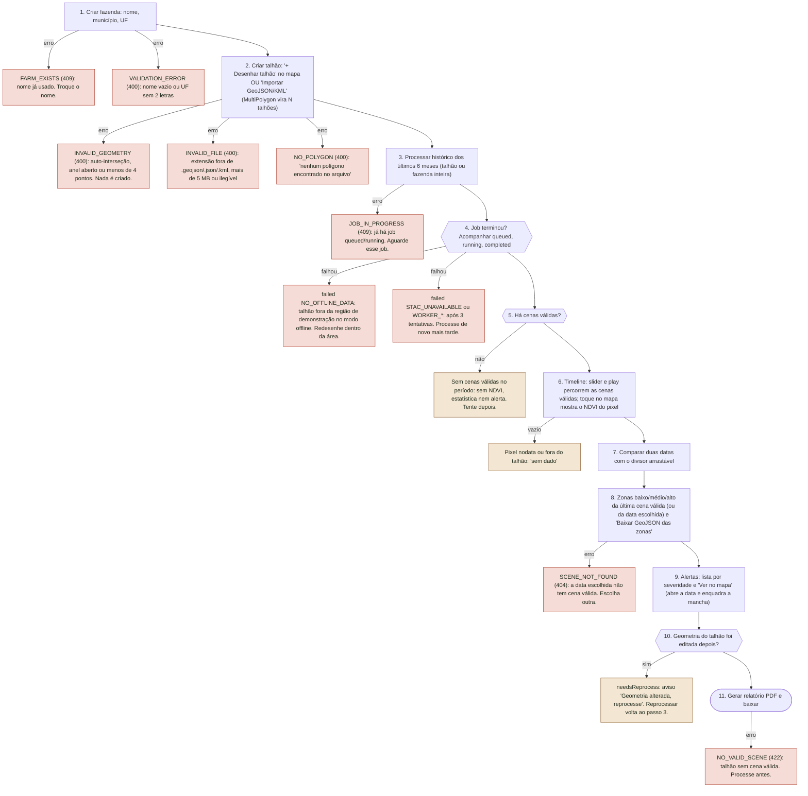
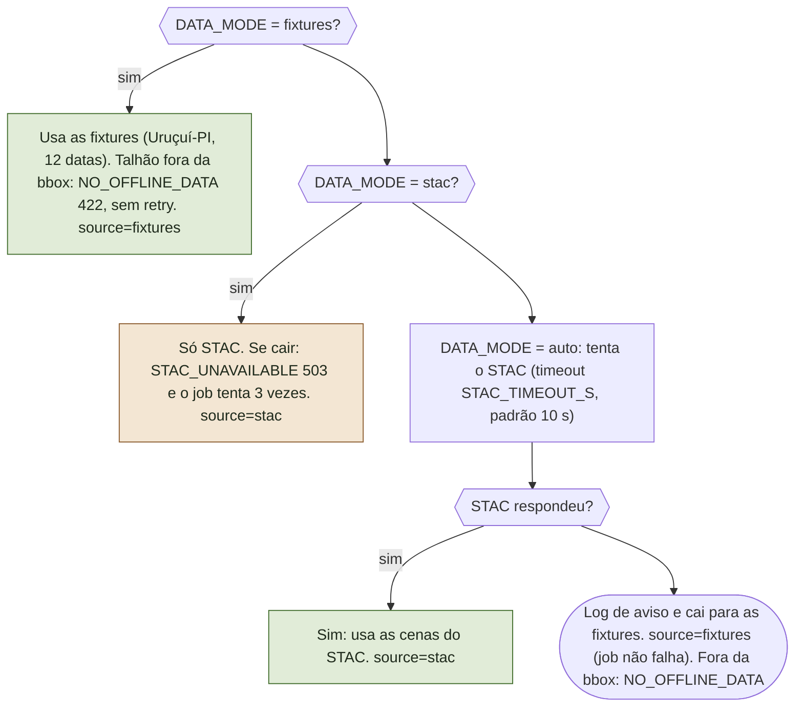
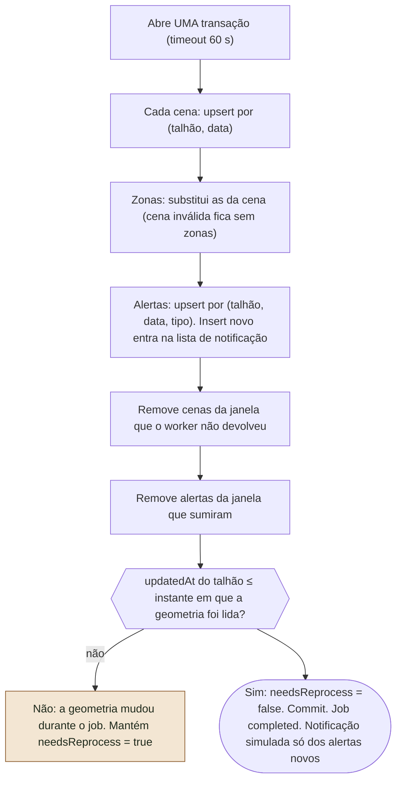
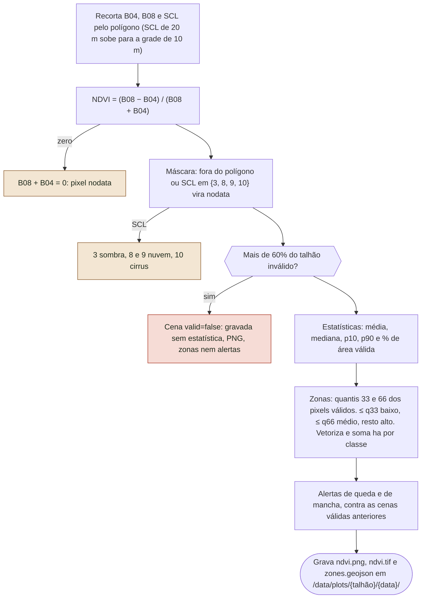
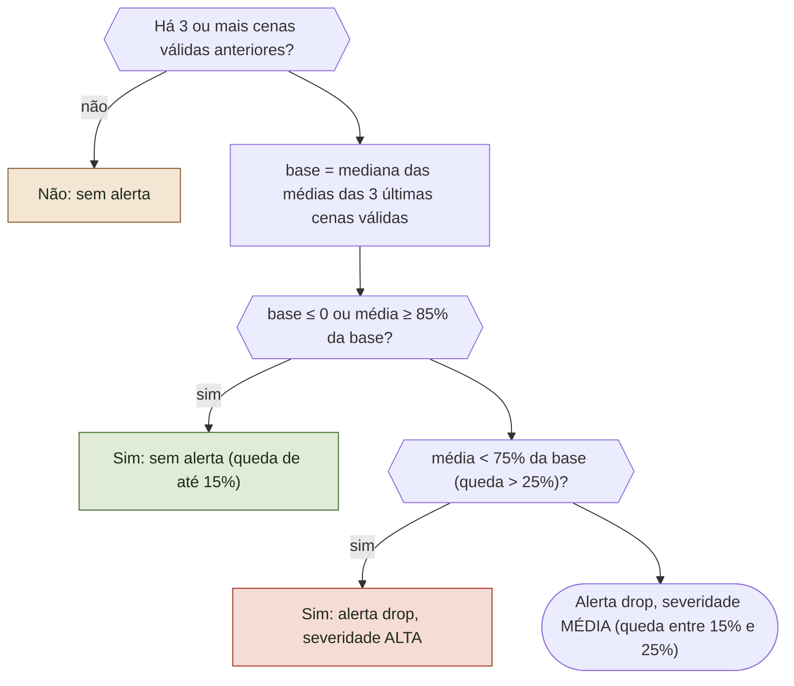
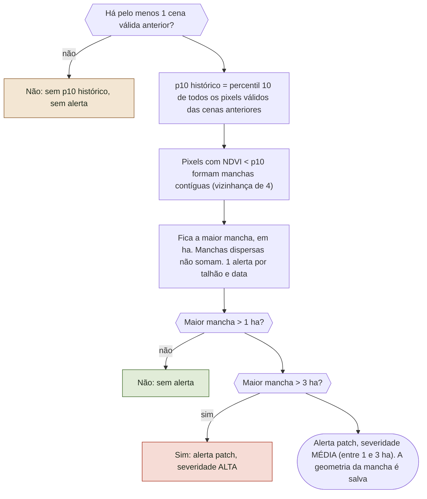
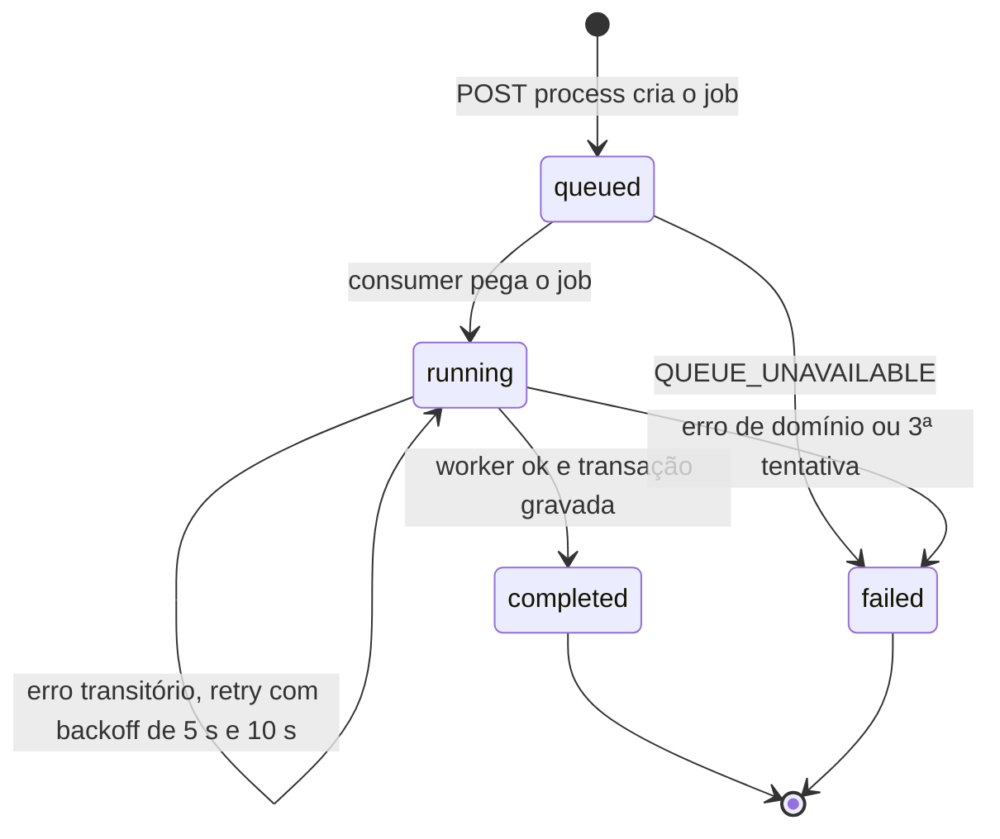
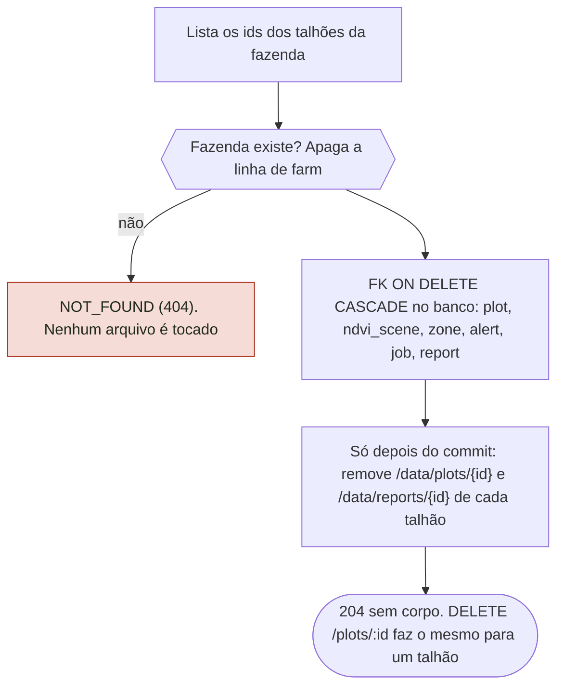

# Fluxos e regras do AgroSat

Gerado a partir de `docs/specs/agrosat-mvp` (RN-01..RN-15, spec) e do código real. Os mesmos diagramas existem em `previews/fluxos-e-regras.html` (sem rede, com alternador desktop/celular). Estados do job seguem o código: `queued`, `running`, `completed`, `failed`.

## A. Jornada de usabilidade

Produtor ou agrônomo, no escritório e no campo. Ramos à direita são caminhos de erro ou vazio.



### Escritório e campo

| Momento | Escritório (desktop) | Campo (celular 375 px) |
|---|---|---|
| Cadastro | Importa o arquivo GeoJSON/KML da propriedade inteira | Desenha o talhão com o dedo sobre o satélite |
| Acompanhar | Painel lateral com série temporal, p10/p90 e marcadores de alerta | Painel vira bottom sheet; timeline com play ocupa a base |
| Decidir | Compara datas e baixa o GeoJSON das zonas para a máquina de taxa variável | Toca na mancha: "Ver no mapa" enquadra e o NDVI do pixel aparece |
| Entregar | Gera e baixa o PDF | Abre o PDF para mostrar ao produtor |

### Erros e estados vazios

| Situação | O que o usuário vê | Código | Origem |
|---|---|---|---|
| Criar fazenda com nome repetido | Já existe uma fazenda com esse nome | FARM_EXISTS 409 | api/src/farms/farms.service.ts:create |
| Desenhar ou importar polígono inválido | Geometria inválida: envie um Polygon GeoJSON válido | INVALID_GEOMETRY 400 | api/src/plots/plots.service.ts:assertValid |
| Arquivo ilegível, extensão errada ou acima de 5 MB | Mensagem de arquivo inválido; nada é criado | INVALID_FILE 400 | api/src/common/geo.ts:parseGeoFile |
| Arquivo sem Polygon nem MultiPolygon | nenhum polígono encontrado no arquivo | NO_POLYGON 400 | api/src/common/geo.ts:parseGeoFile |
| Processar com job ativo | Já existe um processamento em andamento para este talhão | JOB_IN_PROGRESS 409 | api/src/jobs/jobs.service.ts:enqueueOrReuse |
| Talhão fora da região offline | Job failed: Sem dados offline para esta área | NO_OFFLINE_DATA 422 (sem retry) | worker/app/sources/fixtures.py:list_scenes |
| STAC fora do ar em stac | Job failed após 3 tentativas | STAC_UNAVAILABLE 503 | worker/app/sources/stac.py:list_scenes |
| Todas as cenas com mais de 60% inválido | Sem cenas válidas no período | sem erro (cenas valid=false) | worker/app/mask.py:apply_mask |
| Zonas de data sem cena válida | Escolha outra data | SCENE_NOT_FOUND 404 | api/src/zones/zones.service.ts |
| Geometria editada depois do processamento | Geometria alterada, reprocesse | needsReprocess (flag, não é erro) | api/src/plots/plots.repository.ts:update |
| Relatório sem cena válida | Talhão sem cena válida para gerar relatório | NO_VALID_SCENE 422 | api/src/reports/reports.service.ts:enqueue |

## B. Fluxo técnico de processamento

### B1. Sequência completa

```mermaid
sequenceDiagram
    participant Web
    participant API
    participant Fila
    participant Worker
    participant Fonte
    participant Banco
    Web->>API: POST /plots/:id/process
    API->>Banco: Transação: trava o talhão (FOR UPDATE) e procura job queued/running
    API-->>Web: 409 JOB_IN_PROGRESS se já houver job ativo
    API->>Banco: INSERT job (status queued)
    API->>Fila: add history (3 tentativas, backoff exponencial de 5 s)
    API-->>Web: 202 com jobId
    Web->>API: GET /jobs/:id (consulta o status)
    Fila->>API: Consumer entrega o job (concorrência 2)
    API->>Banco: job running; lê o talhão; janela = hoje − 6 meses
    API->>Worker: POST /process (geometria + janela, timeout WORKER_TIMEOUT_MS)
    Worker->>Fonte: list_scenes conforme DATA_MODE (stac, fixtures ou auto com fallback)
    Fonte-->>Worker: Arquivos B04, B08 e SCL por data
    Worker->>Worker: Pipeline: NDVI, máscara, estatísticas, zonas e alertas
    Worker->>Worker: Grava PNG, GeoTIFF e GeoJSON no volume /data
    Worker-->>API: 200 com source e scenes[]
    API->>Banco: Transação: upsert de cenas, zonas e alertas; remove o que sumiu; needsReprocess
    API->>Banco: job completed com validScenes, discardedScenes e source
    API->>API: Notificação simulada: log notification.simulated (telefone ***)
    Web->>API: GET scenes, zones e alerts: desenha o mapa
    Note over Web,Banco: Falha: erro de domínio (NO_OFFLINE_DATA, NO_VALID_SCENE, NOT_FOUND) vira failed na 1ª vez, sem retry
    Note over Web,Banco: Falha transitória (WORKER_TIMEOUT, WORKER_UNAVAILABLE, STAC_UNAVAILABLE, INTERNAL): reenfileira até 3 tentativas; failed só na última
```

### B2. Fonte de dados



### B3. Persistência transacional



## C. Regras de negócio

### C1. Pipeline por cena (RN-01, RN-02, RN-03, RN-07)



### C2. Alerta de queda (RN-08, RN-10)



### C3. Alerta de mancha (RN-09, RN-10)



### C4. Estados do job



### Limiares conferidos no código

| Regra | Valor | Constante |
|---|---|---|
| Pixel inválido (SCL) | {3, 8, 9, 10} | worker/app/mask.py:INVALID_SCL |
| Descarte da cena | mais de 60% inválido | worker/app/mask.py:MAX_INVALID_PCT |
| Zonas | quantis 33 e 66 | worker/app/zones.py:make_zones |
| Queda: mínimo de cenas | 3 anteriores válidas | worker/app/alerts.py:MIN_PREV_SCENES |
| Queda média / alta | média < 0,85 × base; alta < 0,75 × base | worker/app/alerts.py:DROP_MEDIUM, DROP_HIGH |
| Mancha média / alta | maior mancha > 1 ha; alta > 3 ha | worker/app/alerts.py:PATCH_MEDIUM_HA, PATCH_HIGH_HA |
| Retries | 3 tentativas, backoff exponencial de 5 s | api/src/jobs/jobs.service.ts:ATTEMPTS |
| Janela do histórico | hoje − 6 meses até hoje | api/src/jobs/jobs.processor.ts:handle |
| Upload | até 5 MB; .geojson, .json, .kml | api/src/common/geo.ts:MAX_FILE_BYTES |

## D. Matriz regra, implementação e teste

| Regra | Onde está implementada | Teste que cobre |
|---|---|---|
| RN-01 NDVI e máscara SCL | worker/app/ndvi.py:ndvi; worker/app/mask.py:apply_mask | test_ndvi_mask.py: test_ndvi_values, test_zero_sum_is_nodata, test_scl_classes_masked, test_outside_polygon_ignored |
| RN-02 Descarte acima de 60% | worker/app/mask.py:apply_mask; worker/app/pipeline.py:process_plot | test_ndvi_mask.py: test_coverage_threshold; test_pipeline.py: test_scenes_and_invalid |
| RN-03 Estatísticas | worker/app/stats.py:scene_stats; api/src/jobs/result.persister.ts:persist | test_stats.py: test_stats, test_all_nodata |
| RN-04 Área em ha (geography) | api/src/plots/plots.repository.ts:insert/update (ST_Area) | api/test/integration/db.int-spec.ts (área calculada no SQL); plots.spec.ts (cria com areaHa) |
| RN-05 Desenho ou upload; MultiPolygon explodido | api/src/common/geo.ts:parseGeoFile; api/src/plots/plots.service.ts:importItems | api/test/plots-import.spec.ts (MultiPolygon, KML, INVALID_FILE, NO_POLYGON, transação) |
| RN-06 Histórico de 6 meses | api/src/jobs/jobs.processor.ts:handle | Sem teste da janela (lacuna). Indireto: jobs.spec.ts (processor) |
| RN-07 Zonas por quantis 33/66 | worker/app/zones.py:make_zones; api/src/zones/zones.service.ts | test_zones.py; api/src/zones/zones.spec.ts (padrão, download, SCENE_NOT_FOUND) |
| RN-08 Alerta de queda | worker/app/alerts.py:drop_alert | test_alerts.py: test_drop_needs_three_scenes, test_drop_severity; test_pipeline.py: test_problem_plot_alerts |
| RN-09 Alerta de mancha | worker/app/alerts.py:historical_p10, patch_alert | test_alerts.py: test_patch_severity, test_patch_without_history, test_scattered_pixels_do_not_add_up |
| RN-10 Severidades | worker/app/alerts.py (DROP_*, PATCH_*) | test_alerts.py: test_drop_severity, test_patch_severity |
| RN-11 Notificação simulada | api/src/notifications/notifications.service.ts:notifyNew/whatsapp/emit | notifications.spec.ts; api/test/notifications-privacy.spec.ts |
| RN-12 Sem auth, tenant único | Ausência de guard em api/src/app.module.ts (decisão) | Sem teste (não há comportamento a verificar) |
| RN-13 DATA_MODE com fallback | worker/app/sources/__init__.py:list_scenes | test_sources.py: test_auto_falls_back, test_fixtures_mode_no_stac; test_stac.py |
| RN-14 Fixtures e bbox offline | worker/app/sources/fixtures.py:list_scenes | test_fixtures.py; test_sources.py: test_outside_bbox |
| RN-15 PDF e recomendações | worker/app/report.py:recommendations/build_pdf; api/src/reports/reports.service.ts:enqueue | test_report.py: test_direction, test_recommendations, test_pdf; reports.spec.ts |
| Job: fila, retry, 409 | api/src/jobs/jobs.service.ts:enqueueOrReuse; jobs.processor.ts:handle | api/src/jobs/jobs.spec.ts (JOB_IN_PROGRESS, retry só na última, UnrecoverableError) |
| Persistência idempotente e needsReprocess | api/src/jobs/result.persister.ts:persist | api/test/integration/persister.int-spec.ts (2x mantém contagens; needsReprocess não zera) |
| Exclusão em cascata | api/src/farms/farms.service.ts:remove; FKs em api/prisma/schema.prisma | api/test/integration/farm-delete.int-spec.ts; db.int-spec.ts (cascata) |
| Telefone não persistido | api/src/notifications/notifications.service.ts:emit | api/test/notifications-privacy.spec.ts (log sem dígitos; schema sem coluna phone) |

### Divergências spec x código

- Estado do job: spec (RF-13) e código usam completed, não succeeded. Durante os retries o status continua running (não volta a queued); failed só na última tentativa ou em erro de domínio.
- Alta de queda confirmada no código: média < 0,75 × base (queda > 25%). Em exatamente 85% ou 75% a regra é estrita (sem alerta em 85%; média em 75%). Código ainda ignora base ≤ 0, o que a spec não cita.
- STAC pré-filtra eo:cloud_cover < 60 na busca (worker/app/sources/stac.py), além do descarte RN-02 por talhão. Não está na spec.
- Fixtures ignoram a janela de datas e devolvem as 12 cenas (comentário P1 em fixtures.py). Por isso o histórico offline não é limitado a 6 meses.
- RN-06 (janela de 6 meses) não tem teste dedicado.
- Em modo stac/auto o polígono do talhão é enviado ao STAC público (intersects). A spec não trata isso como dado pessoal; ver aba LGPD.

## E. Mapa de LGPD

| Dado | Onde é guardado | O que é logado | Exclusão |
|---|---|---|---|
| Nome, município e UF da fazenda (pode identificar o produtor) | Postgres: tabela farm | Não é logado | DELETE /farms/:id (cascata) |
| Nome e contorno do talhão (localização da propriedade) | Postgres: plot (PostGIS) | Não é logado | DELETE /plots/:id ou da fazenda |
| NDVI, zonas, alertas e estatísticas derivados | Postgres (ndvi_scene, zone, alert) e /data/plots/{talhão}/{data}/ | Só o alertId no log de notificação | Cascata + remoção das pastas após o commit |
| Relatórios PDF (nome do talhão, alertas) | Postgres: report e /data/reports/{talhão}/ | Não é logado | Cascata + remoção da pasta |
| Jobs (errorCode, errorMessage, result) | Postgres: job | Erro interno loga stack no servidor, sem payload pessoal | Cascata |
| Telefone (opcional em POST /notifications/whatsapp) | Nunca persistido: sem coluna phone; só em memória na chamada | notification.simulated com phone "***" | Nada a apagar |
| Polígono enviado ao STAC público (modos stac e auto) | Não fica guardado por nós; sai da máquina na consulta | Aviso quando cai para fixtures | Use DATA_MODE=fixtures para nada sair |
| Conta, e-mail, cookies, localStorage | Não existem (sem auth, RN-12). Aviso em /privacidade | - | - |

### Exclusão em cascata


